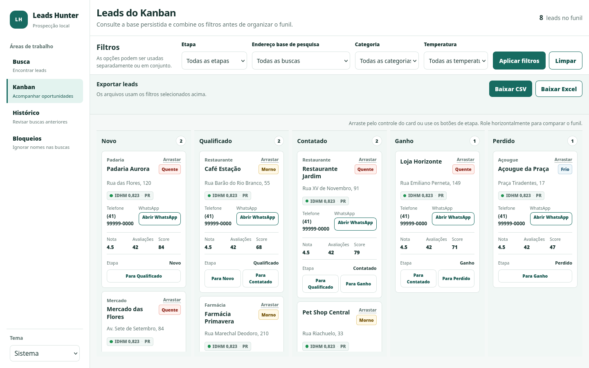
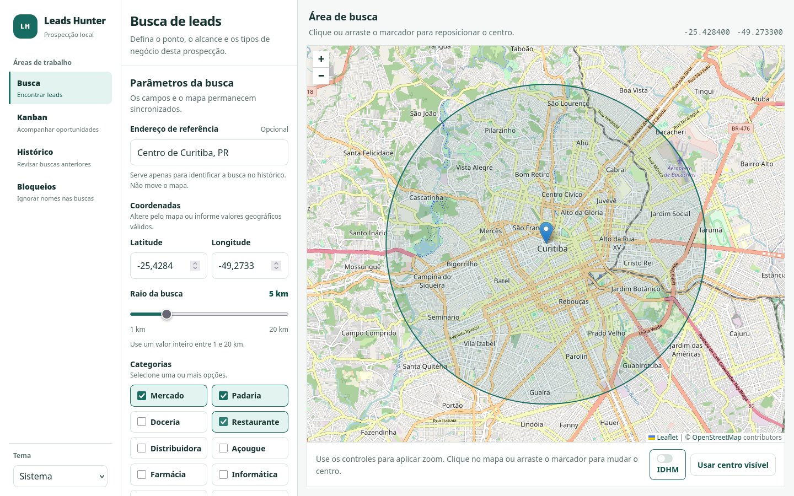
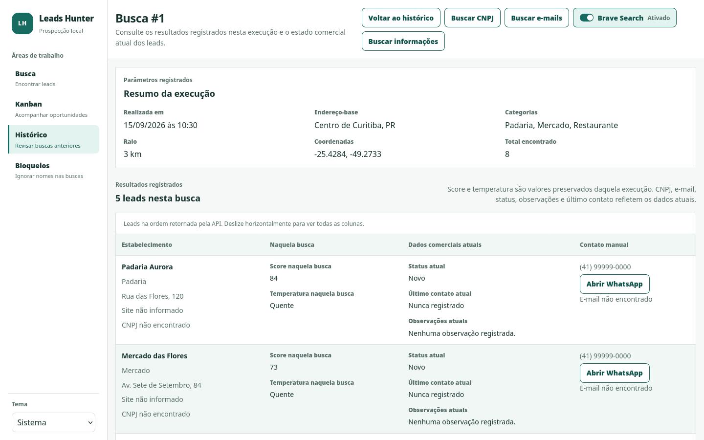

# Leads Hunter

**Prospecção local de estabelecimentos, do mapa ao acompanhamento comercial.** Escolha uma região e categorias, consulte a Google Places API (New), priorize os leads encontrados e acompanhe cada contato em um Kanban. A aplicação roda localmente, com Angular, Spring Boot e MySQL.



> Interface real do projeto. Os nomes, telefones e demais dados exibidos nas capturas são fictícios; as respostas da API foram simuladas para a demonstração.

[Como funciona](#como-funciona) · [Funcionalidades](#funcionalidades) · [Executar localmente](#executar-localmente) · [Documentação](#documentação)

## Como funciona

1. **Encontre:** defina o ponto no mapa, um raio de até 20 km e uma ou mais categorias. O backend consulta a Google Places e registra a busca.
2. **Priorize:** estabelecimentos são deduplicados por `googlePlaceId`, filtrados pelos nomes bloqueados, enriquecidos com dados locais quando disponíveis e classificados por score e temperatura.
3. **Acompanhe:** mova os leads entre `Novo → Qualificado → Contatado → Ganho/Perdido`, registre observações, consulte buscas anteriores e exporte os resultados filtrados.

Cada busca mantém o score e a temperatura calculados naquela execução. Status, observações e último contato pertencem ao lead e permanecem quando ele aparece em outra busca.

| Busca por região e categoria | Detalhe de uma busca anterior |
| --- | --- |
| [](docs/images/busca.png) | [](docs/images/historico.png) |

*As duas telas acima também usam dados de demonstração fictícios. Clique para ampliar.*

## Funcionalidades

- **Busca e histórico:** múltiplas categorias, cache e limite local de chamadas à Google, além do registro das execuções e dos leads encontrados.
- **Leads e funil:** cinco etapas, filtros combináveis por etapa, categoria, temperatura e busca de origem, paginação por coluna e atualização de observações.
- **Dados complementares:** município/UF e IDHM de dataset offline; correspondência de CNPJ com uma base pública importada pelo próprio usuário.
- **Pesquisa de informações:** ação explícita no Histórico para verificar site e Instagram. Pode consultar a API oficial do Brave, quando configurada, e validar páginas candidatas com limites de leitura.
- **Pesquisa de e-mails:** ação explícita que examina o site oficial já conhecido do lead, confirma a identidade do estabelecimento e aceita apenas endereço do domínio próprio.
- **Contato e exportação:** telefone e link manual do WhatsApp, CSV e Excel com os filtros aplicados. A aplicação não envia mensagens nem e-mails.

A base de CNPJ não acompanha o repositório. Sem importá-la, a busca e o Kanban continuam funcionando, mas o preenchimento de CNPJ por correspondência local fica indisponível. O IDHM e o CNPJ não compõem o score atual.

## Arquitetura

```text
Angular + Leaflet/OpenStreetMap
    │ /api pelo proxy de desenvolvimento
    ▼
Spring Boot: controllers → serviços → repositories/integrações
    ├── MySQL: leads, buscas, vínculos e execuções de enriquecimento
    ├── Google Places API (New): estabelecimentos
    ├── Brave Search API: fonte opcional para pesquisa de informações
    └── dataset local: município e IDHM
```

`Busca` registra a execução; `Lead` representa o estabelecimento deduplicado; `BuscaLead` faz a relação N:N e preserva score e temperatura da execução. O Flyway controla o schema e o Hibernate o valida (`ddl-auto: validate`). Veja o [fluxo interno](fluxo.md) para as regras de cada operação.

| Camada | Tecnologias principais |
| --- | --- |
| Backend | Java 25, Spring Boot 4.1, Maven, JPA/Hibernate, Flyway |
| Banco | MySQL 8 |
| Frontend | Angular 22, TypeScript 6, Leaflet, OpenStreetMap |
| Testes | JUnit/Mockito/MockMvc, Vitest, Playwright |

As dependências e as decisões de escolha estão em [tecnologias.md](tecnologias.md).

## Executar localmente

### Requisitos

- JDK 25 e MySQL 8 em `localhost:3306`.
- Node.js e npm para o frontend (validados neste projeto com Node 26 e npm 12).
- Uma chave própria da **Google Places API (New)** para realizar buscas reais. A chave do Brave Search é opcional.
- Acesso à internet para as APIs externas e para os tiles do OpenStreetMap.

O Maven Wrapper (`./mvnw`) já está no repositório.

### 1. Prepare o banco

No MySQL, crie o schema e um usuário local dedicado. Substitua `sua_senha` por uma senha sua:

```sql
CREATE DATABASE leadsradar CHARACTER SET utf8mb4 COLLATE utf8mb4_unicode_ci;
CREATE USER 'leadhunter'@'localhost' IDENTIFIED BY 'sua_senha';
GRANT ALL PRIVILEGES ON leadsradar.* TO 'leadhunter'@'localhost';
```

Se o MySQL estiver em outro host ou contêiner, adapte o endereço de conexão e o host do usuário. Na primeira inicialização, o Flyway cria as tabelas; não é preciso executar SQL de schema manualmente.

### 2. Configure e inicie a API

```bash
cp .env.example .env
# Preencha DB_PASSWORD e GOOGLE_PLACES_API_KEY no .env
set -a
source .env
set +a
./mvnw spring-boot:run
```

O modelo usa `DB_USERNAME=leadhunter`; ajuste-o se escolheu outro usuário. O `.env` local fica fora do Git. O Spring Boot lê **variáveis de ambiente**, portanto é preciso carregar o arquivo antes de iniciar a API. O backend atende em `http://localhost:8080`; `GET /api/health` retorna o estado básico da aplicação.

Uma chave Google ausente não impede a inicialização, mas uma busca real responde `503`. Sem chave Brave, a pesquisa de informações ainda pode verificar o site oficial conhecido; a consulta ao Brave fica indisponível.

### 3. Inicie a interface

Em outro terminal:

```bash
cd frontend
npm ci
npm start
```

Abra `http://localhost:4200`. O proxy do Angular encaminha `/api` ao backend local. O endereço digitado no formulário identifica a busca no Histórico; o ponto consultado é definido pelas coordenadas ou pelo mapa.

## Validar

```bash
./mvnw test
./mvnw package
```

```bash
cd frontend
npm test
npm run build
npm run e2e:smoke
```

O teste E2E de smoke usa respostas de API simuladas. Os testes de integração do backend usam um catálogo MySQL isolado e exigem permissão para criá-lo e removê-lo. Neste ambiente com Java 25, os testes Mockito exigiram iniciar a JVM de testes com o `-javaagent` do Byte Buddy; isso não afeta a execução normal da aplicação.

Para o smoke E2E, mantenha o frontend em execução com `npm start` em outro terminal e instale os navegadores do Playwright se ainda não estiverem disponíveis.

## Dados opcionais e limites

- **CNPJ:** o pipeline de [importação da base pública](tools/cnpj/README.md) prepara um recorte por municípios para o MySQL. A aplicação não consulta a Receita Federal durante a execução.
- **IDHM:** o dataset municipal já está incluído no backend; a geração/atualização está em [`tools/idhm/`](tools/idhm/).
- **Pesquisa de informações:** a leitura de páginas candidatas serve para confirmar telefone, endereço ou CNPJ. Há teto de três consultas ao Brave e três páginas por lead. O scraper de motores de busca está desativado por padrão.
- **Pesquisa de e-mails:** lê no máximo duas páginas do mesmo host do site oficial por lead; não faz disparos.
- **Uso previsto:** aplicação local para uma pessoa, sem autenticação ou deploy. Cache e limite de requisições ficam em memória e reiniciam com o processo.

## Documentação

| Documento | Quando consultar                                                         |
| --- |--------------------------------------------------------------------------|
| [API.md](API.md) | Rotas, parâmetros, respostas e erros HTTP                                |
| [fluxo.md](fluxo.md) | Sequência interna da busca, do enriquecimento, do Kanban e da exportação |
| [tecnologias.md](tecnologias.md) | Stack e decisões técnicas                                                |
| [frontend/README.md](frontend/README.md) | Estrutura e comandos próprios do Angular                                 |
| [tools/cnpj/README.md](tools/cnpj/README.md) | Download, preparação e importação da base de CNPJ,   Era pra um caso especifico idealizado no inicio, não é necessário                     |
| [HISTORICO_IMPLEMENTACOES.md](HISTORICO_IMPLEMENTACOES.md) | Evolução das implementações                                              |
